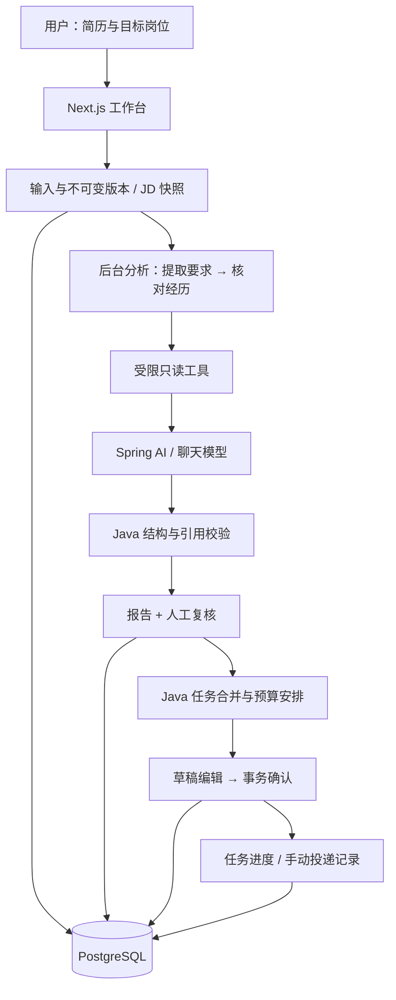

# JobCompass 当前架构

最后核对：2026-10-13。本文件描述已实现结构，未来方案在 [实施计划](实施计划.md) 中标记。原架构文档中的规划内容已按当前源码更新；上游基础功能及 Git 历史保留。

## 1. 从使用流程看模块

新分析直接读取简历和岗位快照，不走知识库召回。上游知识库使用独立的 pgvector 检索流程，提供写作与岗位建议。

## 2. 目录与职责

| 位置 | 当前职责 |
|---|---|
| `backend/src/main/java/com/resumeai/compass` | 新输入、证据分析、复核、预算与计划跟踪 |
| 原 `interfaces / application / domain / infrastructure / agent` | 上游接口、实体、知识库、改写、文件与模型设施 |
| `backend/src/main/resources/db/migration` | Flyway；V1–V4 保留，V5–V9 为原三项改造，V10 新增追问与证据卡，V11 添加分析统计 JSONB |
| `frontend/src/app/compass` | 输入、分析选择、预算和计划列表 |
| `frontend/src/app/evidence-analyses/[id]` | 状态查询、证据报告、复核与失败重试 |
| `backend/src/main/java/com/resumeai/compass/experience` | 针对要求追问、回答保存、证据卡与历史确认 |
| `frontend/src/app/evidence-analyses/[id]/experience/[inquiryId]` | 回答、草稿预览、确认、复制/下载及重新编辑 |
| `frontend/src/app/preparation-plans/[id]` | 草稿调整、确认、进度与事件 |
| `frontend/src/app/applications` | 手动投递状态和备注 |
| `frontend/src/lib/api/compass.ts` | 新前后端请求和类型约定 |
| `deploy / scripts / .run` | 基础服务编排、本机启动和 IDEA 配置 |
| `samples / docs` | 虚构评估输入、结果、使用与维护文档 |

新模块复用 Spring JDBC、已有事务管理器、文档解析和对象存储；没有为二改重写原 JPA 分层。原删除接口加入窄范围保护，避免删除已被新业务引用的资料。

## 3. 分析执行与证据边界

`SnapshotService` 保存正文、SHA-256 和分段，锁定父简历串行分配版本号。分析绑定固定版本，岗位快照写入 `analysis_run`；失败重试继续使用原资料。

`EvidenceService` 保存运行后将任务提交到 2 线程、8 等待名额的本机队列。队列满保留失败记录并返回 429。前端轮询报告；启动时将遗留运行标记为 `FAILED / INTERRUPTED`，没有持久化自动调度。

`SpringAiEvidenceModel` 先提取 1–20 条 JD 要求，再逐条核对简历。每阶段最多两次尝试，每次创建独立的 `JobCompassReadTools`，只能读当前 ID 范围且最多四次访问。工具没有写数据库或投递能力。

`EvidenceValidator` 检查字段、状态、要求 ID、段落 ID 和逐字引用。缺少经历记录默认不确定；明确缺口规则偏保守，引用校验不保证理解完全正确。人工复核独立保存，原模型判断保留。提示词与校验配合约束正文指令，但不是完整安全认证体系。

`AnalysisMetrics` 每次分析单独创建，通过 CallAdvisor 在结构转换前取得 ChatClient 工具循环累计用量；在每阶段的 finally 中记录耗时、工具读取和失败代码，成功/失败快照分别随运行结果保存到 V11 的 `analysis_run.metrics_json`。没有增加模型请求或数据库表；不记录提示词、工具正文、模型正文或凭据。用量不完整时保留部分统计、总量置空；历史记录仍为空。若网络中断前服务商已产生用量但没有返回，客户端无法准确统计账单。

FULL 工具快照保持原结构；COMPACT 仅移除重复正文、哈希、时间等分析不需要的元数据，保留 ID 与全部原文分段。两种模式共用原提示词、范围校验、工具次数上限和证据校验。模型模式可以用 `jobcompass.evidence.snapshot-mode` 调整；启用决定由独立验收集对照结果记录，不能因 Token 变少就认定质量合格。统计仅覆盖新证据分析，未给原改写和追问增加统计。

## 4. 经历追问与证据卡

报告入口选择一项要求，`ExperienceService` 绑定原报告、要求和简历版本；每条要求仅有一个追问会话。`SpringAiExperienceModel` 用已固定资料生成三个问题，`ExperienceValidator` 校验数量、类别和字段。模型只生成问题，回答原文由 Java 组织为卡，完整保留否认、限制和不确定，避免生成摘要时反转原意。

追问使用独立 1 线程、4 等待名额；模型网络调用不占数据库事务，每次最多两次尝试。问题完成和回答变更带版本条件；队列拒绝及重启中断保存失败状态。确认在短事务中锁住会话，原子写入确认卡、状态与事件；重复确认幂等。

`experience_inquiry` 保存当前问题、回答和草稿；`experience_evidence_card` 保存不可变确认快照。重新编辑产生新草稿，旧确认卡保留。来源明确为用户补充/用户确认，不写入旧简历或模型报告，不自动设置复核为 MATCH。现有模型和计划模块保持原行为。

## 5. 计划与一致性

`BudgetPlanner` 使用受控技能映射；相同技能和行动类型合并，未知要求保持独立。每岗位取最高要求权重并跨岗位累加，用收益/预计小时排序，在预算内贪心选择，非全局最优。

`PlanningService` 将草稿、任务、来源与复核快照写入数据库。确认时用短事务、计划行锁、确认键和内容哈希，并通过岗位唯一约束创建或复用申请。进度和备注采用显式版本检查，不是新 JPA `@Version`。

模型调用在持久化结果的短事务之外。事件与对应状态变更在同一事务中保存；网络调用不占着确认事务等待。

## 6. 数据归属

| 表或存储 | 内容 |
|---|---|
| `resumes / job_descriptions` | 上游父记录及新增岗位信息 |
| `resume_version` | 不可变简历版本、正文、分段与哈希 |
| `analysis_run / analysis_requirement` | 快照、运行状态、要求和判断 |
| `requirement_review` | 人工复核、备注、技能修正、版本 |
| `preparation_plan / plan_analysis / plan_task / task_requirement` | 草稿、来源、预算任务及要求关联 |
| `job_application / activity_event` | 手动申请记录、变更历史 |
| `experience_inquiry / experience_evidence_card` | V10：追问会话与不可变用户确认卡 |
| `knowledge_documents / vector_store` | 上游知识文档与向量检索 |
| Silo / MinIO API | 原文件及原流程导出文件 |
| Redis | 上游保留基础能力；新分析进度和队列不存这里 |

新版本简历及已有分析/申请引用的岗位受删除保护。当前没有归档入口和完整删除管理流程。

## 7. 运行与扩展范围

Compose 只运行 PostgreSQL + pgvector、Redis 和 Silo；后端在 IDEA/Maven/Java 运行，前端在 Node 运行。本机默认端口 5432、6379、9000/9001、8080、3000。

当前为单用户、单实例范围，没有 SSE 新进度流、动态 Provider、认证、自动投递或云端发布。需要这些能力时从 [实施计划](实施计划.md) 新增任务，并同步接口、手册和验收。

原知识检索遇到异常或没有召回时会尝试文本检索；索引依然需要向量模型。知识建议与个人能力证据不能混用。

原改写复用 `rewrite_drafts.conversation_history` 保存对话与候选快照；生成时只记录候选，不覆盖已应用正文。接受最新候选时，正文、理由、校验信息及候选处理状态在同一事务中保存，导出读取已持久化草稿。2026-10-14 的局部修复没有新增数据库表、迁移或前端请求字段。原改写的模型调用仍在其既有事务方法内，未改成新证据模块的任务队列结构。
